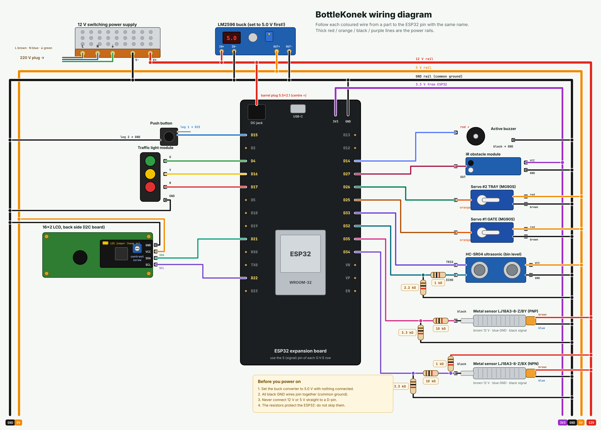

# BottleKonek firmware (ESP32, Arduino IDE)

Plastic bottles → WiFi minutes. The ESP32 joins the main WiFi, broadcasts
**BottleKonek WiFi** with a sign-in portal, and only passes internet to phones
that still have minutes. It also runs the bottle machine.



## Files

| File | What it does |
|---|---|
| `BottleKonek/BottleKonek.ino` | Start-up, main loop, phone list, timer |
| `BottleKonek/config.h` | **Edit this first**: main WiFi name/password, admin password, pins, servo angles |
| `BottleKonek/network.ino` | Hotspot, internet sharing (NAT), packet filter, DNS relay |
| `BottleKonek/accounts.ino` | Accounts, passwords (SHA-256 + salt), balances, history in flash |
| `BottleKonek/machine.ino` | Sensors, servos, LCD, LEDs, buzzer, bin level |
| `BottleKonek/web.ino` | Portal website, captive-portal redirects, student and admin API |
| `BottleKonek/portal_html.h` | Student website (works offline) |
| `BottleKonek/admin_html.h` | Admin page |
| `BottleKonek/logo_jpg.h` | School logo |
| `wiring.png` / `wiring.svg` | Picture wiring diagram (made by `make_wiring_png.py`) |

## 1. Install Arduino IDE and the ESP32 board

1. Install **Arduino IDE 2.x**.
2. **File → Preferences → Additional boards manager URLs**, add:
   `https://espressif.github.io/arduino-esp32/package_esp32_index.json`
3. **Tools → Board → Boards Manager**, search **esp32**, install
   **esp32 by Espressif Systems, version 3.x** (3.0.0 or newer is required).
4. **Library Manager**: install **LiquidCrystal I2C** (by Frank de Brabander). If the IDE
   warns it "may be incompatible" with ESP32, ignore that; it works. Nothing else is
   needed; WiFi, WebServer, LittleFS and Preferences come with the ESP32 board package.

## 2. Edit `config.h`

```cpp
#define MAIN_WIFI_SSID      "your router or pocket WiFi name"
#define MAIN_WIFI_PASSWORD  "its password"
#define ADMIN_PASSWORD      "choose a new one"
```

## 3. Upload

* **Tools → Board**: `ESP32 Dev Module`
* **Tools → Partition Scheme**: `Default 4MB with spiffs`
* **Tools → Port**: the ESP32's USB port
* Click **Upload**. Open **Serial Monitor** at **115200** to see messages
  (main WiFi connected, phones joining, bottles accepted).

## 4. Wiring summary

| Part | Pin | ESP32 | Notes |
|---|---|---|---|
| 12 V supply | V+ / V− | — | to buck IN, ESP32 DC jack, both metal sensors (brown/blue) |
| LM2596 buck | OUT+ / OUT− | — | **set to 5.0 V first**; feeds servos, LCD, HC-SR04 |
| LCD 16×2 (I2C board) | SDA / SCL | D21 / D22 | VCC → 5 V, GND → GND. Contrast = blue screw on the I2C board |
| Servo gate (MG90S #1) | orange | D25 | red 5 V, brown GND |
| Servo tray (MG90S #2) | orange | D26 | red 5 V, brown GND |
| Metal sensor BX (NPN) | black | D34 | 1 kΩ pull-up to 12 V, then 10 kΩ to D34, 3.3 kΩ D34→GND |
| Metal sensor BY (PNP) | black | D35 | 10 kΩ to D35, 3.3 kΩ D35→GND |
| IR obstacle module | OUT | D27 | VCC 3V3 |
| HC-SR04 | TRIG / ECHO | D33 / D32 | ECHO through 1 kΩ, 2.2 kΩ D32→GND · VCC 5 V |
| Traffic light | G / Y / R | D4 / D16 / D17 | GND to GND |
| Buzzer | red | D14 | black to GND |
| Button | one leg | D15 | other leg to GND |

All grounds join together: power supply V−, buck OUT−, ESP32 GND, sensors.

**Extra parts to buy:** resistors 1 kΩ ×2, 2.2 kΩ ×1, 3.3 kΩ ×2, 10 kΩ ×2,
one DC barrel
plug 5.5×2.1 mm with wires for the ESP32 jack, and a perfboard or terminal blocks.

## 5. First test (before building the cabinet)

1. Power on. LCD shows **BottleKonek 4821**, green LED on. Blank or only boxes on
   the LCD: turn the blue screw on its I2C board. Serial Monitor tells you if the LCD was found.
2. Serial Monitor shows `Main WiFi connected`.
3. On a phone, join **BottleKonek WiFi**. The sign-in page should pop up by itself.
   If not, open any `http://` site or `http://192.168.4.1`.
4. Tap **Drop bottles**, hold an empty bottle in front of the IR sensor → **+5 min**.
   Hold a can near the metal sensors → **Rejected: metal**.
5. Tap **Done · start internet**. Browse a website.
6. Admin page: `http://192.168.4.1/admin` (password from `config.h`).

## 6. Calibrate

* **Servo angles**: change `GATE_*` and `TRAY_*` in `config.h` so the tray tips
  bottles into the bin and back out of the return slot.
* **IR**: turn its screw until the LED lights only when a bottle sits on the tray.
* **Metal sensors**: they detect metal within about 8 mm, so mount them close to
  where the item rests.
* **Bin**: measure ultrasonic → bin bottom (empty) and ultrasonic → top of a full bin,
  enter both on the admin page.

## Limits

* About 8 phones at once (ESP32 hotspot limit), shared speed roughly 5–10 Mbps.
* Without a capacitive sensor, the machine only rejects metal. Paper cups or bottles
  with water are accepted. Add an `LJC18A3-B-Z/BY` on a free pin and set
  `PIN_PLASTIC` in `config.h` to require plastic.
* Accounts are stored on the ESP32 itself; they survive power cuts and re-uploads,
  but **Tools → Erase All Flash** deletes them.
